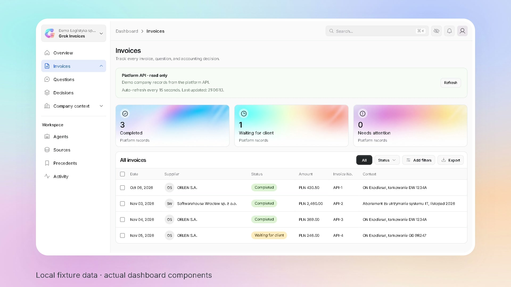

<p align="center">
  
</p>

<p align="center">
  <a href="https://grok.stackinghq.com">Open dashboard</a> ·
  <a href="https://grok.stackinghq.com/docs">Explore the API</a> ·
  <a href="docs/grok-bot-setup.md">Connect your bots</a> ·
  <a href="#run-locally">Run locally</a>
</p>

---

## Accounting, with context

The demo follows a fuel invoice for an unfamiliar vehicle, `GD 9R247`: open a case, ask the client for the missing facts, and keep the answer with the resulting decision.

**Grok Invoices is the agents’ office:** a shared platform for KSeF purchase invoices, company context, accounting decisions and their history. The agents run as Grok Bots over dedicated MCP connections. The platform stores state and enforces rules; it never calls a model itself.

| Invoice agent | Regulations agent | Client assistant |
| :--- | :--- | :--- |
| Brings invoices in, checks applicable precedents and escalates unfamiliar cases. | Works through context and sources, asks for missing facts and records the rationale. | Collects documents and answers, then explains the results to the client. |
| [Bot instructions →](apps/api/invoice-agent-template.md) | [Bot instructions →](apps/api/regulations-agent-template.md) | [Bot instructions →](apps/api/client-agent-template.md) |

The client talks to a Grok Bot; the dashboard provides supervision. This is a **single-company hackathon demo using KSeF TEST**. The Polish stage demo uses chat and narrates the planned phone interaction. Each bot pass is requested explicitly: saving an answer reopens the platform case, but does not wake another bot. End-to-end Grok Bot, private vault and Pages acceptance remains outstanding in the project notes.

## Watch the demo

[](brag-output-dashboard-v3/narrated.mp4)

[Play or download the video (MP4, 24 seconds)](https://github.com/artpods56/grok-invoices/raw/refs/heads/preview/narrated-dashboard-demo/brag-output-dashboard-v3/narrated.mp4)

Actual dashboard components with synthetic fixture data. English narration, a distinct client-assistant voice in the micro-demo, and calm instrumental music generated with ElevenLabs. This is a scripted product illustration, not a recording of a live bot conversation or KSeF transaction.

## A calm view of every case

<p align="center">
  
  <br>
  <sub>Selected design mockup with updated branding · synthetic example data · not a screenshot of production activity.</sub>
</p>

Search, filter, export CSV, or inspect the recorded posting, source and case history behind an invoice. The **Next.js + Tailwind dashboard** is a read-only view of the shared platform. A status card is a view of a record, not proof that a bot or external integration completed successfully.

| Workspace | Agent access | Platform | Invoice intake |
| :--- | :--- | :--- | :--- |
| Next.js · React · Tailwind | Grok Bots · FastMCP | FastAPI · Python 3.13 · SQLite | ksef2 · KSeF TEST |

## Run locally

Requires **Python 3.13**, [uv](https://docs.astral.sh/uv/getting-started/installation/), **Node.js 22+** and npm. Start the backend from the repository root:

```sh
uv sync --locked
uv run uvicorn grok_invoices.entrypoints.http:app --reload
```

The server runs at http://127.0.0.1:8000, with interactive API docs at `/docs`.
See [AGENTS.md](AGENTS.md) for the architecture and conventions.

Start the dashboard in a second terminal:

```sh
cd apps/web
npm ci
npm run dev -- --hostname 127.0.0.1 --port 4173
```

Open **http://localhost:4173**. Stop either process with **Ctrl+C**. No Docker required for development.

The dashboard's server-side `API_BASE_URL` defaults to `http://127.0.0.1:8000`. A fresh backend starts without invoices or precedents. For local fixtures, set `SAMPLE_DATA=true` before creating the database, then use `POST /api/ksef/sync?source=fixtures`. Existing databases retain their state until explicitly reset.

## Agent MCP servers

Create three Grok Bots using the linked instructions and connect them over stateless HTTP to the implemented MCP servers. Each server checks its own invite on every request. An empty setting refuses the connection.

- Invoice agent: `/agents/invoices/mcp`, setting `INVOICE_AGENT_TOKEN`
- Regulations agent: `/agents/regulations/mcp`, setting `REGULATIONS_AGENT_TOKEN`
- Client assistant: `/agents/client/mcp`, setting `CLIENT_INVITE_TOKEN`

Send the token as `?invite=` or the `X-Invite` header. Prefer the header, so the token stays out of the URL. Each token opens only its own server.

See [copy-ready prompts and setup](docs/grok-bot-setup.md) and the
[legal-validation runbook](docs/legal-validation.md). The regulations MCP can acquire official
ELI metadata, text and change pages. Retrieval is not legal approval or an installed watcher.

<details>
<summary><strong>Deployment & infrastructure</strong></summary>

Every push to `main` starts `.github/workflows/deploy.yml`: backend tests, dashboard tests
and a Next.js build gate deployment to https://grok.stackinghq.com. The server builds both
containers and waits for their health checks; if startup fails, it attempts to roll back
to the previous release. The workflow then checks the public `/health` and `/` endpoints.

Put runtime secrets such as API keys in `/srv/grok-invoices/.env` on the server,
then redeploy. To persist data, write under `DATA_DIR` (`/data`), which survives deploys.

Changes to `deploy/` don't apply on push. To apply `compose.prod.yaml` or
`deploy.sh`, re-run `deploy/install.sh` on the server.
`install.sh` leaves an existing nginx site alone because certbot has edited it, so
copy changes to the `location` blocks in `deploy/nginx.conf` into
`/etc/nginx/sites-available/grok-invoices` by hand.

Each release runs two containers: FastAPI on `127.0.0.1:8010` and the dashboard on
`127.0.0.1:8011`. nginx sends `/api`, `/agents`, `/docs`, `/redoc`, `/openapi.json`
and `/health` to FastAPI, and everything else to the dashboard.

</details>

## Platform API

The shared state agents work through lives under `/api`. The contract is at
[`/docs`](https://grok.stackinghq.com/docs) and `/openapi.json`.

Reads are public and expose shared demo records; there is no per-user or per-company isolation.
Writes need `Authorization: Bearer $PLATFORM_API_KEY`. The key is in `/srv/grok-invoices/.env`
on the server; locally, leave it unset to skip the check.

- `POST /api/demo/issue-fuel-invoice` issues the stage demo's invoice on KSeF TEST.
- `POST /api/ksef/sync?source=test` fetches new invoices from KSeF TEST. Omitting `source` also selects TEST.
- `POST /api/ksef/sync?source=fixtures` loads three sample invoices only where `SAMPLE_DATA=true`, for local demonstrations and tests.
- `POST /api/demo/reset` clears shared state and restores the configured seed. Coordinate with the team before resetting a running demo.

With `SAMPLE_DATA` disabled, the current seed contains Cisowa Logistyka (NIP `6421983078`),
its fleet and accounts, with no invoices or precedents. Updating the seed does not replace
an existing database, so it does not describe the current production contents.

KSeF integration targets TEST only. The stage invoice has 23% VAT; any 50% deduction belongs
to the posting, not the invoice. Legal evidence is stored as text, and precedent checks cover
the implemented vehicle conditions; the platform does not validate legal applicability or
automatically invalidate precedents after a law changes.

Bumping `STORE_VERSION` in `unit_of_work.py` rebuilds the database from the seed on the next
start, which discards existing data.

<details>
<summary><strong>Client onboarding & secret configuration</strong></summary>

The client assistant uses one `CLIENT_INVITE_TOKEN` for the demo's single shared company.
The instructions are in `apps/api/client-agent-template.md`. A valid invite grants access;
`start_onboarding` records the NIP and company name, replacing the existing company identity.
It does not create a separate tenant.

In addition to the platform key and agent invites above, client onboarding needs these
settings in `/srv/grok-invoices/.env`:

- `CLIENT_INVITE_TOKEN`, the secret the bot sends as `?invite=` or the `X-Invite` header.
- `SECRET_ENCRYPTION_KEY`, a Fernet key for the KSeF token. Generate one with
  `python -c "from cryptography.fernet import Fernet; print(Fernet.generate_key().decode())"`.

Point the bot at `https://grok.stackinghq.com/agents/client/mcp?invite=<token>`.
The platform API key is not accepted on this endpoint. A missing setting, a missing
invite, or a wrong invite is refused. Pass the KSeF token privately from the bot's vault to
`configure_ksef`, never through chat. The platform verifies it against KSeF TEST and encrypts
it at rest; status exposes only its last four characters. Submitted document text is available only through
the authenticated regulations MCP, not public reads.

</details>

---

<p align="center">
  <br>
  <strong>Built at Grok Bot Hackathon · Wrocław · 2026</strong><br>
  <sub>Grok Bots · KSeF TEST · Shared accounting workspace</sub>
</p>
