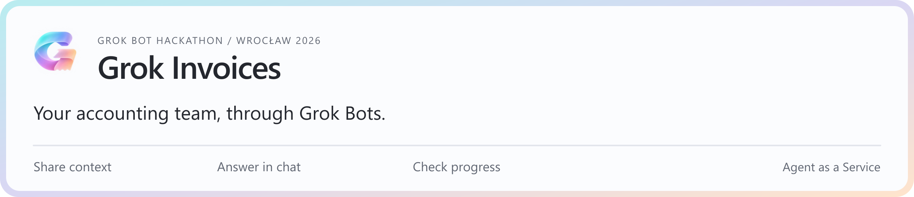
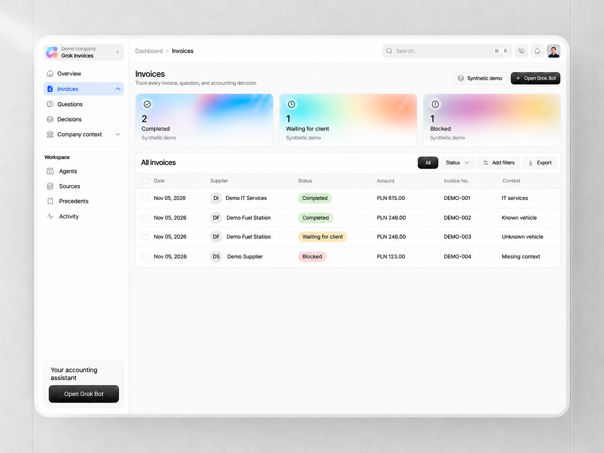

<p align="center">
  
</p>

<p align="center">
  <a href="https://grok.stackinghq.com">Open dashboard</a> ·
  <a href="https://grok.stackinghq.com/docs">Explore the API</a> ·
  <a href="docs/grok-bot-setup.md">Connect your bots</a> ·
  <a href="#run-locally">Run locally</a>
</p>

---

## Accounting, with context

A fuel invoice arrives. The vehicle is unfamiliar. Instead of guessing, the agents open a case, ask the client for the missing facts, and keep the answer with the resulting decision.

**Grok Invoices is the agents’ office:** a shared platform for KSeF purchase invoices, company context, accounting decisions and their history. The agents run as Grok Bots over dedicated MCP connections. The platform stores state and enforces rules; it never calls a model itself.

| Invoice agent | Regulations agent | Client assistant |
| :--- | :--- | :--- |
| Brings invoices in, checks applicable precedents and escalates unfamiliar cases. | Works through context and sources, asks for missing facts and records the rationale. | Collects documents and answers, then explains the results to the client. |
| [Bot instructions →](apps/api/invoice-agent-template.md) | [Bot instructions →](apps/api/regulations-agent-template.md) | [Bot instructions →](apps/api/client-agent-template.md) |

## A calm view of every case

<p align="center">
  
  <br>
  <sub>Selected design mockup with updated branding · synthetic example data · not a screenshot of production activity.</sub>
</p>

Search, filter, export CSV, or inspect the recorded posting, source and case history behind an invoice. The **Next.js + Tailwind dashboard** is a read-only view of the shared platform. A status card is a view of a record, not proof that a bot or external integration completed successfully.

| Workspace | Agent access | Platform | Invoice intake |
| :--- | :--- | :--- | :--- |
| Next.js · React · Tailwind | Grok Bots · FastMCP | FastAPI · Python 3.13 · SQLite | ksef2 · KSeF TEST |

## Run locally

Requires **Python 3.13**, [uv](https://docs.astral.sh/uv/getting-started/installation/), **Node.js 22+** and npm. Start the backend from the repository root:

```sh
uv sync --locked
uv run uvicorn grok_invoices.entrypoints.http:app --reload
```

The server runs at http://127.0.0.1:8000, with interactive API docs at `/docs`.
See [AGENTS.md](AGENTS.md) for the architecture and conventions.

Start the dashboard in a second terminal:

```sh
cd apps/web
npm ci
npm run dev -- --hostname 127.0.0.1 --port 4173
```

Open **http://localhost:4173**. Stop either process with **Ctrl+C**. No Docker required for development.

## Agent MCP servers

Three Grok Bots connect over stateless HTTP. Each server checks its own invite on every request. An empty setting refuses the connection.

- Invoice agent: `/agents/invoices/mcp`, setting `INVOICE_AGENT_TOKEN`
- Regulations agent: `/agents/regulations/mcp`, setting `REGULATIONS_AGENT_TOKEN`
- Client assistant: `/agents/client/mcp`, setting `CLIENT_INVITE_TOKEN`

Send the token as `?invite=` or the `X-Invite` header. Prefer the header, so the token stays out of the URL. Each token opens only its own server.

See [copy-ready prompts and setup](docs/grok-bot-setup.md) and the
[legal-validation runbook](docs/legal-validation.md). The regulations MCP can acquire official
ELI metadata, text and change pages. Retrieval is not legal approval or an installed watcher.

<details>
<summary><strong>Deployment & infrastructure</strong></summary>

Every push to `main` deploys to https://grok.stackinghq.com through
`.github/workflows/deploy.yml`. The server builds the release, waits for `/health`
to pass, and rolls back to the previous release if it fails.

Put runtime secrets such as API keys in `/srv/grok-invoices/.env` on the server,
then redeploy. To persist data, write under `DATA_DIR` (`/data`), which survives deploys.

Changes to `deploy/` don't apply on push. To apply `compose.prod.yaml` or
`deploy.sh`, re-run `deploy/install.sh` on the server.
`install.sh` leaves an existing nginx site alone because certbot has edited it, so
copy changes to the `location` blocks in `deploy/nginx.conf` into
`/etc/nginx/sites-available/grok-invoices` by hand.

Each release runs two containers: FastAPI on `127.0.0.1:8010` and the dashboard on
`127.0.0.1:8011`. nginx sends `/api`, `/agents`, `/docs`, `/redoc`, `/openapi.json`
and `/health` to FastAPI, and everything else to the dashboard.

</details>

## Platform API

The shared state agents work through lives under `/api`. The contract is at
[`/docs`](https://grok.stackinghq.com/docs) and `/openapi.json`.

Writes need `Authorization: Bearer $PLATFORM_API_KEY`. The key is in `/srv/grok-invoices/.env`
on the server; locally, leave it unset to skip the check.

- `POST /api/demo/issue-fuel-invoice` issues the stage demo's invoice on KSeF TEST.
- `POST /api/ksef/sync?source=test` fetches new invoices from KSeF TEST.
- `POST /api/ksef/sync?source=fixtures` loads three sample invoices only where `SAMPLE_DATA=true`. Production has no sample data.
- `POST /api/demo/reset` restores the seed so the demo can run again.

Bumping `STORE_VERSION` in `unit_of_work.py` rebuilds the database from the seed on the next
start, which discards existing data.

<details>
<summary><strong>Client onboarding & secret configuration</strong></summary>

Each client gets the same Grok Bot instructions and its own MCP link. The instructions
to paste into the bot are in `apps/api/client-agent-template.md`. Connecting with a
valid invite registers that client.

The server needs two settings in `/srv/grok-invoices/.env`:

- `CLIENT_INVITE_TOKEN`, the secret the bot sends as `?invite=` or the `X-Invite` header.
- `SECRET_ENCRYPTION_KEY`, a Fernet key for the KSeF token. Generate one with
  `python -c "from cryptography.fernet import Fernet; print(Fernet.generate_key().decode())"`.

Point the bot at `https://grok.stackinghq.com/agents/client/mcp?invite=<token>`.
The platform API key is not accepted on this endpoint. A missing setting, a missing
invite, or a wrong invite is refused. The KSeF token is encrypted at rest. The API
returns only its last four characters. Submitted document text is available only through
the authenticated regulations MCP, not public reads.

</details>

## Project notes

- [Dashboard visual direction](docs/design/dashboard-direction.md)
- [Current context and demo scope](docs/project-context.md)
- [Polish accounting workflow and official sources](docs/research/polish-accounting-and-sources.md)
- [Keeping an AI agent's regulatory knowledge current](docs/research/ai-regulatory-knowledge.md)
- [Live source access checks and limitations](docs/research/source-checks.md)

Repository content and commit messages are written in English. Commit messages should stay short and descriptive.

## Dashboard development

The dashboard is a Next.js + Tailwind app in `apps/web/`, deployed in its own container beside FastAPI. It reads platform records through a server-side GET proxy. See [web setup and container configuration](apps/web/README.md).

Requires Node.js 22 or later and npm. From the repository root:

```powershell
cd apps/web
npm ci
npm run dev -- --hostname 127.0.0.1 --port 4173
```

Open http://localhost:4173. Stop the server with Ctrl+C. Run `npm test` for domain, adapter and proxy tests, and `npm run build` for the production bundle. `API_BASE_URL` defaults to the local FastAPI server at port 8000 and can be changed at runtime for a container network.

---

<p align="center">
  <br>
  <strong>Built at Grok Bot Hackathon · Wrocław · 2026</strong><br>
  <sub>Authentic AI session exports in <code>/sessions</code>. No fabricated history.</sub>
</p>
